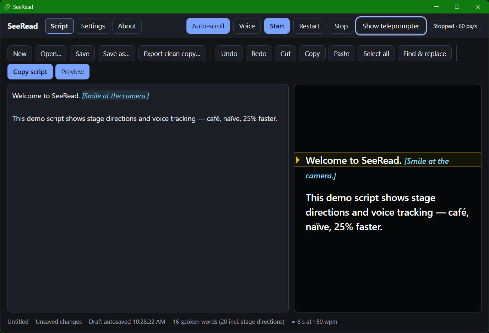

# SeeRead

**A privacy-conscious, open-source desktop teleprompter that floats over your screen and follows your voice — entirely on your own computer.**

[](https://github.com/clintgalendez/SeeRead/actions/workflows/ci.yml)
[](https://github.com/clintgalendez/SeeRead/actions/workflows/codeql.yml)
[](LICENSE)

SeeRead lets you read a script naturally while recording videos, presenting, streaming, rehearsing or
sitting in a video call. Put the teleprompter next to your camera, press Start, and either let it scroll
at a steady pace or let it listen and keep up with you.

- **Floating overlay** — a see-through, always-on-top window you can drag, resize, mirror and style.
- **Voice tracking** — on-device speech recognition follows the words you say, tolerates pauses,
  repeats, skipped passages and misrecognitions, and never jumps around between repeated phrases.
- **Automatic scrolling** — no microphone needed; smooth, adjustable speed with optional
  paragraph pauses, countdown, looping and instant manual override.
- **Stage directions** — `[Pause and smile.]` stays visible but is never expected to be spoken.
  Delimiters are configurable.
- **Script editor** — paste or type, open and save plain-text files, find and replace, undo/redo,
  word count, reading-time estimate, autosave and crash recovery.
- **Private by design** — no account, no cloud, no telemetry, no network connections.

> **Status: early release (0.1).** Windows is the primary validated platform; macOS and Linux builds
> are compiled and unit-tested in CI but have not yet been validated by hand. See the
> [feature matrix](#platform-support) for exactly what is known to work where.

## Contents

- [Install](#install)
- [Quick start](#quick-start)
- [Voice tracking](#voice-tracking)
- [Stage directions](#stage-directions)
- [Keyboard shortcuts](#keyboard-shortcuts)
- [Hiding the teleprompter from screen capture](#hiding-the-teleprompter-from-screen-capture)
- [Platform support](#platform-support)
- [Privacy](#privacy)
- [Developing SeeRead](#developing-seeread)
- [Contributing](#contributing) · [Security](#security) · [Roadmap](#roadmap) · [License](#license)

## Install

Download the installer for your system from the
[Releases page](https://github.com/clintgalendez/SeeRead/releases):

| System                    | File                                    |
| ------------------------- | --------------------------------------- |
| Windows 10/11 (64-bit)    | `SeeRead_x.y.z_x64-setup.exe` or `.msi` |
| macOS 11+ (Apple & Intel) | `SeeRead_x.y.z_universal.dmg`           |
| Linux (x86-64)            | `.AppImage` or `.deb`                   |

Each release lists SHA-256 checksums (`SHA256SUMS`) and carries GitHub build-provenance
attestations. Verify a download with `gh attestation verify <file> --repo clintgalendez/SeeRead`.

Builds are **unsigned** until code-signing certificates are configured, so Windows SmartScreen
and macOS Gatekeeper will warn on first launch. See [docs/releasing](docs/releasing/RELEASING.md).

## Quick start

1. Open SeeRead. A short guide explains the microphone, the overlay and capture limitations.
2. Paste your script into the editor (or **Open…** a `.txt`/`.md` file).
3. Choose **Auto-scroll** or **Voice**, then press **Start**. The teleprompter appears with a short countdown.
4. Drag the teleprompter by its ⠿ handle; resize it from the bottom-right corner.
5. Press **Space** in the teleprompter to pause, **↑/↓** to change speed, **Esc** to stop.



## Voice tracking

Voice tracking runs the [sherpa-onnx](https://github.com/k2-fsa/sherpa-onnx) speech engine and a
streaming English model **on your computer**. Audio is never recorded, saved or sent anywhere, and the
microphone is only open while voice tracking (or a microphone test) is running — shown by a red
**Mic on** indicator.

- **Setup:** Settings → Voice tracking → choose your microphone → **Test microphone**.
- **Lost your place?** Click the word you are reading, or press **←/→** to nudge.
- **Other languages:** add any sherpa-onnx streaming transducer model folder (encoder, decoder,
  joiner, `tokens.txt`) with **Add model folder…**.
- **Remote recognition services** are not supported. If ever added, they will be opt-in, clearly
  disclosed, and never the default (see [ADR 0003](docs/architecture/adr/0003-speech-recognition.md)).

How tracking works: each recognizer update is aligned against the script near your current position;
small forward moves need little evidence, while skips and re-reads need several matching words, so
repeated phrases and stray words never yank the position. Details in
[ADR 0004](docs/architecture/adr/0004-voice-matching.md).

## Stage directions

Anything inside `[square brackets]` is a stage direction: it stays visible (in its own colour) but voice
tracking skips over it, and it never moves your position.

```text
Welcome to the presentation. [Pause for two seconds and smile.] Today we will discuss our results.
```

In **Settings → Stage directions** you can add `( )`, `{ }`, `< >` or any custom pair, mark whole lines
with a prefix such as `>>`, allow nesting, decide how an unclosed bracket is treated, hide directions,
and choose whether they are included when copying. **Export clean copy…** saves a version without them.

## Keyboard shortcuts

Global shortcuts work even while another app (such as your video call) has focus. All are configurable
in **Settings → Keyboard shortcuts**.

| Action                                | Default (Windows/Linux) | Default (macOS) |
| ------------------------------------- | ----------------------- | --------------- |
| Start / pause                         | Ctrl+Alt+Shift+Space    | ⌘⌥⇧Space        |
| Restart                               | Ctrl+Alt+Shift+R        | ⌘⌥⇧R            |
| Stop                                  | Ctrl+Alt+Shift+S        | ⌘⌥⇧S            |
| Faster / slower                       | Ctrl+Alt+Shift+↑ / ↓    | ⌘⌥⇧↑ / ↓        |
| Toggle click-through (regain control) | Ctrl+Alt+Shift+L        | ⌘⌥⇧L            |
| Show / hide teleprompter              | Ctrl+Alt+Shift+O        | ⌘⌥⇧O            |

In the teleprompter window: **Space** start/pause · **↑/↓** speed · **←/→** back/forward ·
**PgUp/PgDn** jump · **Home** restart · **Esc** stop · **click a word** to continue from there.

## Hiding the teleprompter from screen capture

SeeRead can ask the operating system to leave the teleprompter out of screenshots, recordings and screen
sharing (Settings → Privacy & capture). The setting shows what the OS actually reports back.

| Platform              | Mechanism                                          | What to expect                                                                                                      |
| --------------------- | -------------------------------------------------- | ------------------------------------------------------------------------------------------------------------------- |
| Windows 10 2004+ / 11 | `SetWindowDisplayAffinity(WDA_EXCLUDEFROMCAPTURE)` | Hidden from most capture and sharing tools.                                                                         |
| Older Windows 10      | `WDA_MONITOR`                                      | Appears as a black rectangle instead.                                                                               |
| macOS                 | `NSWindow.sharingType = .none`                     | Best effort: ScreenCaptureKit-based tools (macOS 15+) may still capture it.                                         |
| Linux (X11 / Wayland) | none available                                     | Not supported: the teleprompter appears in captures. On Wayland, share a single window instead of the whole screen. |

**This is never a guarantee.** Cameras filming the screen, remote-desktop sessions, privileged or
driver-level capture, browser-based screen sharing, compositors and OS updates can all still capture
the window. Always check a test recording. SeeRead only uses documented OS features and never tries to
defeat recording software.

## Platform support

Legend: ✅ Implemented and tested · 🟡 Implemented but not fully validated · 🟠 Partially supported ·
🗓️ Planned · ⛔ Unsupported. "Tested" means exercised on real hardware, not just compiled.
Verification details: [docs/platform-support.md](docs/platform-support.md).

| Feature                               | Windows | macOS | Linux |
| ------------------------------------- | :-----: | :---: | :---: |
| Script editor, clipboard, autosave    |   ✅    |  🟡   |  🟡   |
| Open / save dialogs                   |   🟡    |  🟡   |  🟡   |
| Transparent always-on-top overlay     |   ✅    |  🟡   |  🟠¹  |
| Automatic scrolling                   |   ✅    |  🟡   |  🟡   |
| Stage directions                      |   ✅    |  🟡   |  🟡   |
| Speech engine on recorded audio       |   ✅    |  🟡   |  ✅²  |
| Voice tracking with a live microphone |   🟡    |  🟡   |  🟡   |
| Click-through mode                    |   ✅    |  🟡   |  🟠¹  |
| Global shortcuts                      |   ✅    |  🟡   |  🟠³  |
| Multi-monitor placement & DPI changes |   🟡    |  🟡   |  🟡   |
| Screen-capture exclusion              |   ✅⁴   |  🟠   |  ⛔   |
| Remote speech recognition             |   ⛔    |  ⛔   |  ⛔   |

¹ Depends on the compositor. Wayland decides window placement and stacking itself, so SeeRead
only restores the teleprompter's size there, and always-on-top may be ignored (in KDE Plasma, use
<kbd>Alt+F3</kbd> → More Actions → Keep Above Others, or a window rule). Settings explains what your
session allows.
² Checked by the `speech` CI job on Ubuntu with public LibriSpeech recordings.
³ Global shortcuts require X11 (or XWayland); native Wayland sessions do not allow them, and
Settings → Keyboard shortcuts says so when it detects Wayland.
⁴ OS read-back and a GDI screen capture confirmed exclusion; specific recording/meeting apps not yet tried.

## Privacy

SeeRead keeps everything local: scripts are files you choose, settings and a recovery draft live in
SeeRead's app-data folder, audio is processed in memory and discarded, and the app makes no network
requests. The clipboard is only touched when you click Copy, Cut or Paste. Full details:
[docs/PRIVACY.md](docs/PRIVACY.md).

## Developing SeeRead

SeeRead is built with [Tauri 2](https://tauri.app) (Rust) and React + TypeScript.

```sh
# Prerequisites: Node.js 24+, Rust (stable, via rustup), and the Tauri system dependencies:
# https://tauri.app/start/prerequisites/  (Linux also needs libasound2-dev)
npm ci
npm run fetch:model        # downloads and verifies the speech model (~128 MB archive, once)
npm run tauri dev          # run the app with hot reload
```

| Task                   | Command                                                                                        |
| ---------------------- | ---------------------------------------------------------------------------------------------- |
| All web checks         | `npm run check` (format, lint, types, unit + integration)                                      |
| End-to-end tests       | `npm run test:e2e`                                                                             |
| Rust checks            | `cd src-tauri && cargo fmt --check && cargo clippy --all-targets -- -D warnings && cargo test` |
| Real-audio speech test | `cd src-tauri && cargo test -- --ignored` (after `fetch:model`)                                |
| Production build       | `npm run tauri build`                                                                          |
| Benchmarks             | `npm run bench`                                                                                |

More: [setup](docs/development/setup.md) · [testing](docs/development/testing.md) ·
[architecture](docs/architecture/overview.md) · [releasing](docs/releasing/RELEASING.md).

```text
src/core/          pure TypeScript: annotation parser, tokens, voice matcher, auto-scroll, settings
src/features/      UI features (editor, teleprompter, voice tracking, settings, first run)
src/services/      Tauri/browser adapters (files, clipboard, settings store, recognition providers)
src/app/           main window shell          src/overlay/   teleprompter window
src-tauri/src/     Rust: audio + speech, capture exclusion, atomic file storage, tray
tests/             unit, integration, e2e (Playwright) and recorded speech fixtures
```

## Contributing

Contributions are welcome. Please read [CONTRIBUTING.md](CONTRIBUTING.md) and the
[Code of Conduct](CODE_OF_CONDUCT.md). All changes go through pull requests with passing CI.
How authorship and attribution work is described in
[docs/development/CONTRIBUTOR_ATTRIBUTION.md](docs/development/CONTRIBUTOR_ATTRIBUTION.md).

## Security

Please report vulnerabilities privately — see [SECURITY.md](SECURITY.md). For help, see
[SUPPORT.md](SUPPORT.md).

## Roadmap

- Hands-on validation and fixes for macOS and Linux (see the matrix above).
- Code-signed and notarized installers.
- More speech models and languages, including models with script-vocabulary biasing.
- Remote-control from a phone or presenter clicker; rich-text (Markdown) emphasis in scripts.
- Optional, explicitly opt-in remote recognition providers (never the default).

See the [CHANGELOG](CHANGELOG.md) for what has shipped.

## License

SeeRead is licensed under the [Apache License 2.0](LICENSE). Third-party components and the bundled
speech model are listed in the in-app **About** page and in each release's license inventory.
